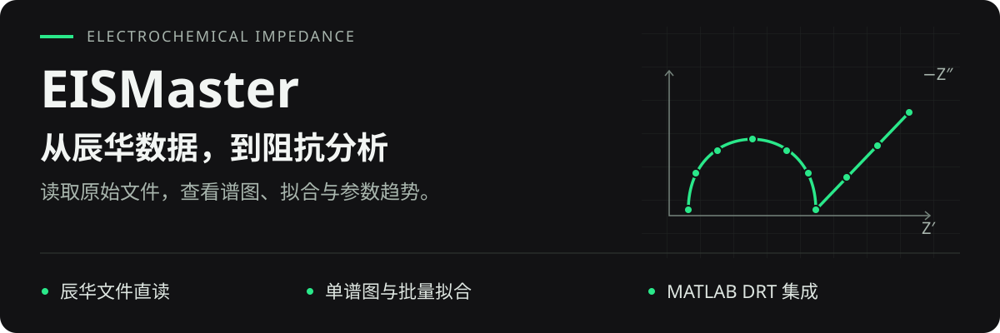
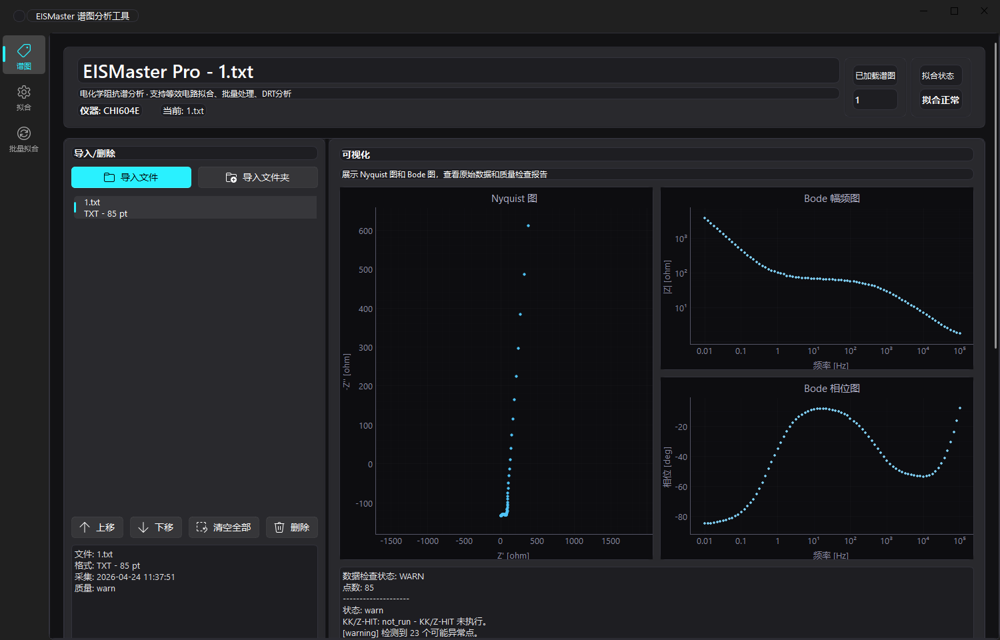
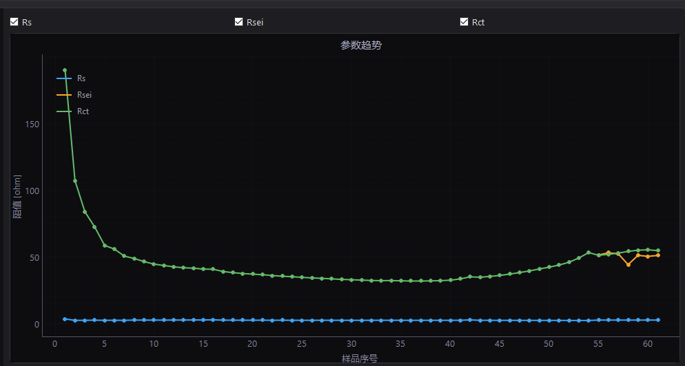

<div align="center">
  
  <h3>把谱图、拟合与批量分析放在一起</h3>
  <p>A desktop workspace for electrochemical impedance analysis.</p>
  <p>
    <a href="pyproject.toml"></a>
    <a href="pyproject.toml"></a>
    <a href="LICENSE"></a>
  </p>
  <p>
    <a href="#核心功能">核心功能</a> ·
    <a href="#快速开始">快速开始</a> ·
    <a href="#常见用法">常见用法</a> ·
    <a href="#使用边界">使用边界</a> ·
    <a href="#文档导航">文档导航</a>
  </p>
</div>

---

EISMaster 是面向电池、材料与电化学研究人员的阻抗谱桌面分析工具，帮助你直接读取辰华数据，在同一界面完成看图、拟合、批量比较和结果导出。



## 核心功能

| 你要处理的问题 | EISMaster 提供的功能 |
| --- | --- |
| 原始文件需要反复转表 | 直接读取辰华 EIS `.bin`、CHI 导出 `.txt` 和按固定列顺序整理的 `.csv` |
| 看图前先确认数据是否正常 | 绘制 Nyquist / Bode 图，提示重复频点、非有限值和可能异常点 |
| 从谱图中提取阻抗参数 | 单弧、双弧和自动识别模式，支持手动调整分界点，查看参数、残差与不确定度 |
| 连续测量的文件太多 | 批量拟合，并按谱图队列比较 `Rs`、`Rsei`、`Rct` 趋势 |
| 希望进一步查看弛豫过程 | 调用 MATLAB DRTtools，提供 Tikhonov、贝叶斯置信区间、BHT 和峰拟合选项 |
| 充放电记录分散在多个文件 | 在 CC 曲线页读取 CHI CP / ISTEP 文件，整理连续时间–电压曲线和分段明细 |
| 需要把结果带到绘图软件 | 导出 TXT、CSV 或 Excel，包含原始绘图数据、拟合曲线和参数摘要 |

## 快速开始

以下为 **Windows PowerShell 源码运行路径**，需要 Git 和 Python 3.11。Python 版本要求来自项目配置；这里固定使用 3.11，与现有启动逻辑一致。

```powershell
git clone https://github.com/Jakiewbe/EISMaster.git
cd EISMaster
py -3.11 -m venv .venv
.\.venv\Scripts\python.exe -m pip install -e ".[advanced]"
.\.venv\Scripts\python.exe -m eismaster
```

`advanced` 包含分段拟合所用的 `pyimpspec`。MATLAB DRT 还需要本机 MATLAB 和适配的 DRTtools 脚本，配置见[使用指南](docs/usage.md#matlab-drt)。

## 常见用法

### 看一张谱图，再做拟合

在「谱图」页点击「导入文件」，查看 Nyquist / Bode 曲线和质量提示；切换到「拟合」页，选择单弧、双弧或「Auto 识别」，调整分界点后点击「开始拟合」。结合残差、参数误差和诊断信息判断结果，再点击「导出数据」。

### 比较一组连续测量

点击「导入文件夹」，检查并调整文件队列顺序，然后在「批量拟合」页运行拟合。勾选 `Rs`、`Rsei` 或 `Rct` 查看趋势，点击趋势点可回看对应谱图，最后导出批量数据。



### 整理充放电曲线

在「CC曲线」页点击「选择 CC 文件夹」，读取符合命名要求的 CP 或 ISTEP 二进制文件，查看时间–电压曲线、曲线明细和分段汇总。该页面可导出 Excel 或 TXT，文件命名规则见[使用指南](docs/usage.md#cc-曲线)。

## 使用边界

- 辰华 `.bin` 解析针对代码中已识别的 EIS、CP 和 ISTEP 数据布局，不代表兼容所有仪器型号或文件版本。
- CSV 按列位置读取：前三列依次为频率（Hz）、阻抗实部（Ω）、阻抗虚部（Ω），不会根据列名自动调整顺序。Nyquist 图显示的是 `−Z″`，输入仍应使用原始 `Z″`。
- 质量提示和拟合结果用于辅助分析；自动识别不能代替对电路、残差和参数合理性的判断。
- MATLAB DRT 依赖外部软件与脚本；本页不声明 Linux、macOS 或全部 MATLAB 版本已实测。
- 当前主线为 Python / PySide6；`rewrite/` 中的 Rust / Tauri 实现用于对照评估，尚未作为等价替代。

## 文档导航

| 文档 | 内容 |
| --- | --- |
| [使用指南](docs/usage.md) | 文件格式、模型选择、MATLAB DRT 配置、导出内容与排错 |
| [Python 与 Rust/Tauri 对照](docs/rust-parity-verdict.md) | 两种实现的定位与替换条件 |
| [Rust 重写计划](rust-rewrite-plan/README.md) | 后续实现的范围与规划 |
| [第三方声明](THIRD_PARTY_NOTICES.md) | DRTtools 来源与许可信息 |

## 许可证

本项目由 Jakiec 以 [MIT License](LICENSE) 发布。MATLAB DRT 集成使用 ciuccislab 的 [DRTtools](https://github.com/ciuccislab/DRTtools)，原项目版权与许可见[第三方声明](THIRD_PARTY_NOTICES.md)。
