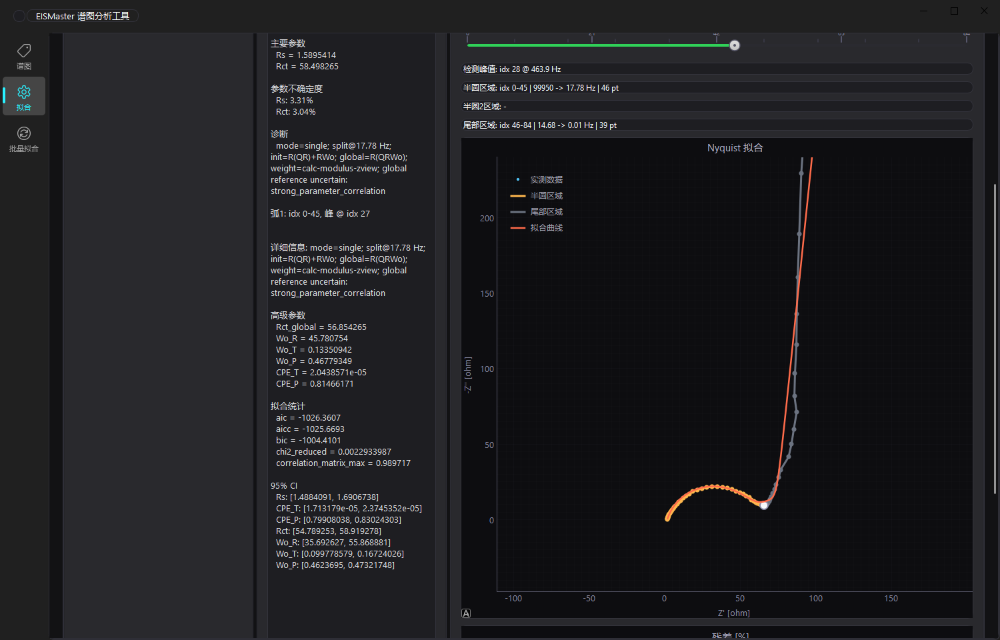
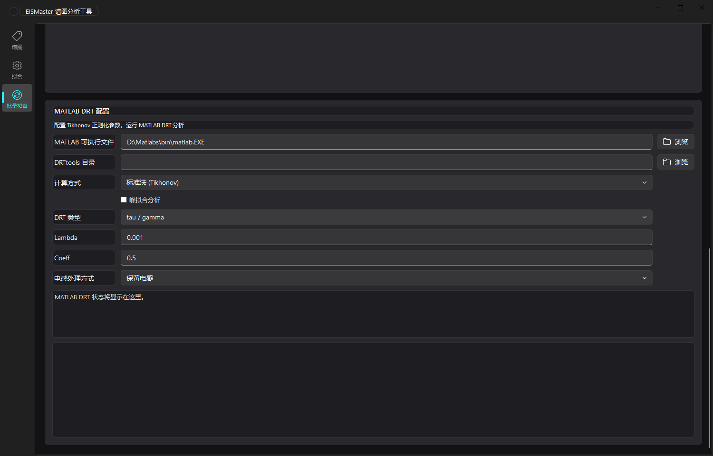

<div align="center">
  
  <h3>把谱图、拟合与批量分析放在一起</h3>
  <p>A desktop workspace for electrochemical impedance analysis.</p>
  <p>
    <a href="pyproject.toml"></a>
    <a href="pyproject.toml"></a>
    <a href="LICENSE"></a>
  </p>
  <p>
    <a href="#核心功能">核心功能</a> ·
    <a href="#快速开始">快速开始</a> ·
    <a href="#使用流程">使用流程</a> ·
    <a href="#拟合模型与工作原理">拟合模型</a> ·
    <a href="#使用边界">使用边界</a> ·
    <a href="#文档导航">文档导航</a>
  </p>
</div>

---

EISMaster 是面向电池、材料与电化学研究人员的阻抗谱桌面分析工具，帮助你直接读取辰华数据，在同一界面完成谱图检查、等效电路拟合、批量比较、MATLAB DRT 和结果导出。

如果你经常处理一组原位 EIS、循环过程或不同工况下的谱图，可以从单个文件开始确认模型，再批量提取参数并查看趋势。对于分散保存的 CHI 充放电记录，独立的 CC 曲线页可以将分段整理成连续的时间–电压曲线。


## 核心功能

| 你要处理的问题 | EISMaster 提供的功能 |
| --- | --- |
| 辰华原始文件需要反复转表 | 直接读取 EIS `.bin`、CHI 导出 `.txt` 和按固定列顺序整理的 `.csv` |
| 文件导入后需要确认数据是否正常 | 显示 Nyquist / Bode 图、原始数据表和质量提示 |
| 想从谱图中提取阻抗参数 | 单弧、双弧和自动识别模式，支持手动分界，输出参数、残差与不确定度 |
| 连续测量的文件多，逐张拟合费时 | 批量处理谱图，比较 `Rs`、`Rsei`、`Rct`，联动查看对应文件 |
| 需要进一步查看弛豫过程 | 调用 MATLAB DRTtools，提供 Tikhonov、贝叶斯置信区间、BHT 和峰拟合选项 |
| 充放电记录保存在多个分段文件中 | 读取 CHI CP / ISTEP 文件，生成时间–电压曲线、逐点明细和分段汇总 |
| 需要将分析结果带到绘图软件 | 导出 TXT、CSV 或 Excel，包含 Nyquist 数据、拟合曲线、参数摘要和已有 DRT 结果 |

## 快速开始

以下为 **Windows PowerShell 源码运行路径**，需要 Git 和 Python 3.11。项目配置要求 Python ≥ 3.11，这里使用 3.11，与现有启动逻辑一致。

```powershell
git clone https://github.com/Jakiewbe/EISMaster.git
cd EISMaster
py -3.11 -m venv .venv
.\.venv\Scripts\python.exe -m pip install -e ".[advanced]"
.\.venv\Scripts\python.exe -m eismaster
```

安装完成后会打开桌面窗口。第一次使用，可以先在「谱图」页点击「导入文件」，选择一个辰华 EIS 文件查看曲线。

`advanced` 包含分段拟合所用的 `pyimpspec`。**谱图查看与等效电路拟合不需要 MATLAB**；MATLAB DRT 需要另外准备 MATLAB、相关工具箱与适配的 DRTtools 脚本。

如果使用已有 Windows 分发包，解压后运行 `EISMaster.exe`，保留同目录的 `_internal/` 等资源。详细配置与启动排错见[使用指南](docs/usage.md#启动与排错)。

## 支持的数据格式

阻抗数据与充放电数据使用不同页面读取：

| 数据 | 格式 | 导入位置 | 要求 |
| --- | --- | --- | --- |
| 辰华 EIS 原始记录 | `.bin` | 谱图页 | 使用解析器已识别的 CHI 阻抗记录布局 |
| CHI 阻抗文本导出 | `.txt` | 谱图页 | 支持 CHI 的 `Freq/Hz` 数据表和纯数值阻抗文本 |
| 整理后的阻抗表格 | `.csv` | 谱图页 | 前三列依次为频率（Hz）、实部 Z′（Ω）、虚部 Z″（Ω） |
| CHI CP / ISTEP 充放电记录 | `.bin` | CC曲线页 | 使用支持的二进制布局与文件命名规则 |

CSV 可以有一行表头，但按**列位置**读取，不会根据列名自动调整顺序。输入虚部应使用原始 `Z″`，Nyquist 图会自动显示为 `−Z″`。

文件夹导入读取所选目录的直接子文件，不递归扫描。EIS 文件按可用的采集时间和文件名排序，也可在队列中手动上移、下移。文件头提供的仪器、时间等信息会随谱图显示。

## 使用流程

主窗口包含「谱图」「拟合」「批量拟合」「CC曲线」四个工作页。EIS 的常用流程是：**导入文件 → 检查谱图 → 选择模型与分界 → 拟合 → 比较参数 → 导出**。DRT 可以直接使用已导入的阻抗数据，不要求先完成电路拟合。

### 1. 谱图页：先看原始数据

导入一个文件或一个文件夹后，在队列中选择谱图，即可同时查看：

- **Nyquist 图**：观察半圆、高频截距和低频尾部。
- **Bode 幅频图与相位图**：查看阻抗模值、相位随频率的变化。
- **数据表与元信息**：核对频率、实部、虚部、点数和文件来源。
- **质量提示**：检查非有限值、非正频率、重复频点、负实部和可能异常点。

可在文件队列中删除、清空或调整顺序，再进入拟合。界面中的 KK 状态目前没有连接执行检查的操作入口，`not_run` 表示未执行，不表示通过。

### 2. 拟合页：选择模型，查看参数与曲线



1. 在队列中选择一个谱图。
2. 选择单弧、双弧或「Auto 识别」。
3. 查看检测出的半圆与尾部区域；必要时手动调整分界点，也可点击「重置」。
4. 点击「开始拟合」，比较实测与拟合曲线，查看残差、参数误差和诊断。
5. 结果确认后，点击「导出数据」。

单弧模式使用一个分界点，双弧模式使用两个分界点。分界点用于区分半圆与扩散尾部，并帮助建立初始参数；它不等于删除尾部数据。

### 3. 批量拟合页：比较连续谱图

先抽查一组文件中的典型谱图，确认模型和队列顺序，再点击「批量拟合」。页面显示处理进度、每张谱图的模型与状态，以及主要参数趋势。


- 勾选 `Rs`、`Rsei`、`Rct`，选择要比较的参数。
- 点击趋势点或选择结果表中的行，回看对应谱图。
- 结合逐谱图状态和参数误差检查异常变化，再点击「导出批量数据」。

趋势横轴是**样品序号**，不会自动转换成时间、温度或 SOC；这类对应关系需要结合你的实验记录整理。

[查看批量工作页](docs/images/3.png) · [查看逐谱图结果表](docs/images/6.png)

### 4. MATLAB DRT：分析弛豫过程



在「批量拟合」页配置 MATLAB 可执行文件、DRTtools 目录、Lambda、Coeff、输出类型和电感处理方式。随后可从「拟合」页运行单谱图 DRT，或从「批量拟合」页运行多个谱图的 DRT。

| 计算选项 | 用途 |
| --- | --- |
| 标准法（Tikhonov） | 通过正则化反演查看 DRT 曲线 |
| 贝叶斯置信区间 | 调用 DRTtools 的置信区间计算 |
| BHT | 调用 DRTtools 的 Bayesian Hilbert Transform 方法 |
| 峰拟合分析 | 先运行标准法，再对 DRT 峰进行分析；勾选后覆盖下拉框中的计算方式 |

输出类型可选 `tau / gamma`、`freq / gamma`、`tau / g` 或 `freq / g`。程序还可将已有结果整理为 DRT 线图数据、云图数据和按 `logτ` 分区的积分结果。

源码仓库不包含本地 `matlab-DRTtools-local/`。所选 DRTtools 副本还需要提供桥接脚本使用的 `apply_loaded_data_to_handles` 接口；仅安装 Python 依赖或提供一个未核对的 DRTtools 目录，不能保证 DRT 运行。准备方法、输出目录和参数说明见[DRT 使用指南](docs/usage.md#matlab-drt)。

### 5. CC 曲线页：合并充放电分段

点击「选择 CC 文件夹」，加载 CHI CP（Chronopotentiometry）或 ISTEP（Multi-Current Steps）记录。程序按样品与充放电方向分组，按相应顺序拼接分段，显示连续的时间–电压曲线。

| 文件类型 | 文件名示例 | 含义 |
| --- | --- | --- |
| CP | `L_S01_CC_4p00V.bin` | `S01` 是样品标识，`4p00V` 是目标电压 |
| ISTEP | `CFx_S01_CC_T20M.bin` | `S01` 是样品标识，`T20M` 是用于排序的时间标记 |

页面下方保留逐点数据、分段编号、来源文件和分段汇总，可导出 Excel 或 TXT。不同样品应使用不同标识，避免被合并到同一组。

EIS、静置和没有完整数据点的 ISTEP 文件不会进入曲线；已识别的 CC 文件若解析失败，会停止本次加载并显示错误。ISTEP 当前按每点 1 秒建立时间轴，使用其他采样间隔的记录前需要核对。完整命名规则见[CC 曲线指南](docs/usage.md#cc-曲线)。

## 拟合模型与工作原理

### 两种电路模型

这里的 `Q` 表示非理想电容 CPE，`Wo` 表示有限长度扩散元件。

| 模型 | 电路结构 | 适用的谱图形态 |
| --- | --- | --- |
| 单弧 | `R(Q(RWo))` | 一个主要半圆与低频扩散尾部 |
| 双弧 | `R(QR)(Q(RWo))` | 两个主要半圆与低频扩散尾部 |

单弧模型在界面中显示为 `Single-arc R(QRWo)`。这两种模板用于组织拟合过程，具体支路代表的物理过程仍需要结合实验体系判断。

| 参数 | 说明 |
| --- | --- |
| `Rs` | 串联欧姆阻抗，通常与高频截距相关 |
| `Rct` | 电荷转移支路阻抗 |
| `Rsei` | 双弧模型中高频支路的阻抗标签，物理含义需结合体系判断 |
| `CPE_T / CPE_P` | 单弧模型的 CPE 系数与指数 |
| `Q1 / n1`、`Q2 / n2` | 双弧模型的两个 CPE 支路参数 |
| `Wo_R / Wo_T / Wo_P` | 有限长度扩散元件的电阻、时间与指数参数 |

### 如何得到拟合结果

1. **识别区域**：根据谱图形态识别半圆与尾部，也接受手动分界。
2. **建立初值**：分别估计半圆、扩散区域的参数，建立完整模型的初始值。
3. **全谱优化**：对阻抗实部和虚部共同进行复数非线性最小二乘拟合，尝试不同起点和权重。
4. **输出诊断**：给出拟合曲线、参数误差、统计量、置信区间及相关性信息；具体内容随结果而定。

分段初始化使用 `pyimpspec`，完整模型的数值优化使用 SciPy。程序也有直接全谱拟合路径，部分批处理初值会利用原生 DRT 估计；这与界面中的外部 MATLAB DRT 工作流是两回事。

判断结果时，应同时看**曲线是否贴合、残差是否有规律、参数误差是否偏大、模型是否合理**。页面提供 `aic`、`aicc`、`bic`、`chi2_reduced` 等统计量，以及有结果时的 95% 置信区间和参数相关性提示。程序返回的状态与诊断同样需要检查，不能仅凭一条平滑曲线确认参数可信。

## 导出结果

单谱图和批量拟合可选择 TXT、CSV 或 Excel；CC 曲线页面提供 Excel 和 TXT。

**Excel 将数据分到独立工作表，TXT / CSV 将它们保存为多个带后缀的文件。** 例如选择 `sample.xlsx` 会生成一个工作簿，选择 TXT 时则会生成 `sample_raw_plot.txt`、`sample_rs_rct.txt` 等文件。

| 工作表 / 文件后缀 | 保存内容 | 生成条件 |
| --- | --- | --- |
| `raw_plot` | Nyquist 原始绘图数据：Z′ 与 −Z″ | 导出所选谱图 |
| `fit_overlay` | 实测与拟合的 Nyquist 曲线数据 | 没有拟合结果时，拟合列为空 |
| `rs_rct` | 文件标识、`Rs`、`Rct`、`Rsei`、`Wo_R / Wo_T / Wo_P` | 参数按实际拟合结果填写 |
| `fit_report` | 模型、参数、统计量、质量和诊断信息 | 单谱图已有拟合与质量结果 |
| `drt_line_plot` | DRT 线图所需的横轴与幅值数据 | 已有对应 DRT 结果 |
| `drt_cloud_density` | 整理后的 DRT 云图数据 | 已有对应 DRT 结果 |
| `drt_quant_area` | 按 `logτ` 区间积分的结果 | 已有对应 DRT 结果 |
| `cc_curve` / `cc_segments` | CC 逐点曲线与分段汇总 | 在 CC曲线页导出 |

导出的数值表可用于 Origin、Excel、MATLAB 或 Python 后续绘图。`raw_plot` 和 `fit_overlay` 中的虚部已经转换为 Nyquist 绘图方向，不应再次反号。

## 使用边界

- **文件兼容性**：辰华二进制解析针对已识别的数据布局，不代表兼容所有仪器型号或文件版本。
- **分析解释**：质量提示、自动分界与模型识别用于辅助分析，不能代替对原始数据和实验体系的判断。
- **外部依赖**：MATLAB DRT 需要另行准备 MATLAB、工具箱和适配脚本，Python 安装不会自动提供它们。
- **平台范围**：快速开始给出 Windows 路径，不声明 Linux、macOS 或全部 Python / MATLAB 版本已实测。
- **实现定位**：Python / PySide6 是当前主线。`rewrite/` 中的 Rust / Tauri 实现用于对照评估，尚未作为等价替代；后续替换条件见[对照文档](docs/rust-parity-verdict.md)。

## 开发与项目结构

| 目录 / 文件 | 作用 |
| --- | --- |
| [pyproject.toml](pyproject.toml) | Python 版本、依赖和启动命令 |
| [src/eismaster/app.py](src/eismaster/app.py) | 桌面程序启动入口 |
| [src/eismaster/io/](src/eismaster/io/) | 辰华 EIS 与 CC 文件解析 |
| [src/eismaster/analysis/](src/eismaster/analysis/) | 数据质量、分段、拟合和批量分析 |
| [src/eismaster/ui/](src/eismaster/ui/) | 四个工作页、绘图与后台任务 |
| [src/eismaster/exporters.py](src/eismaster/exporters.py) | EIS、拟合及 DRT 结果导出 |
| [matlab_bridge/](matlab_bridge/) | MATLAB DRTtools 桥接脚本 |
| [tests/](tests/) | 解析、拟合、导出和界面相关检查 |

开发依赖与检查命令见[开发指南](docs/usage.md#开发与检查)。涉及解析或计算的修改，应使用对应数据核对结果；反馈问题时说明文件类型、操作步骤与错误信息即可。

## 文档导航

| 文档 | 内容 |
| --- | --- |
| [使用指南](docs/usage.md) | 文件要求、操作细节、MATLAB DRT、CC 曲线和启动排错 |
| [Python 与 Rust/Tauri 对照](docs/rust-parity-verdict.md) | 两种实现的定位与替换条件 |
| [Rust 重写计划](rust-rewrite-plan/README.md) | 后续实现的范围与规划 |
| [第三方声明](THIRD_PARTY_NOTICES.md) | DRTtools 来源与许可信息 |

## 许可证

本项目由 Jakiec 以 [MIT License](LICENSE) 发布。MATLAB DRT 集成使用 ciuccislab 的 [DRTtools](https://github.com/ciuccislab/DRTtools)，原项目版权与许可见[第三方声明](THIRD_PARTY_NOTICES.md)。
