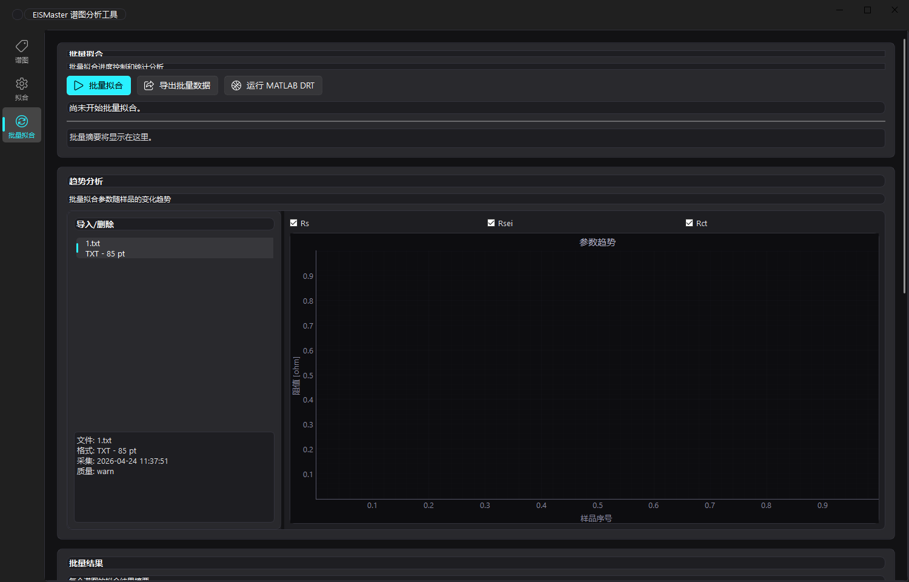
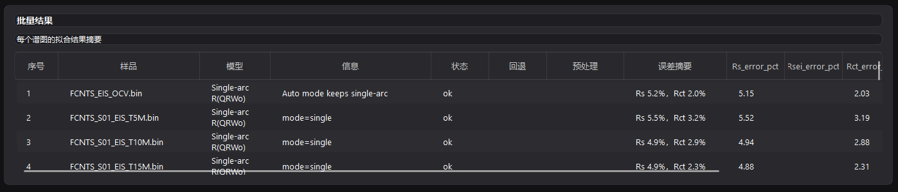

# EISMaster 使用指南

[返回产品首页](../README.md)

## 输入文件

| 页面 | 输入 | 要求 |
| --- | --- | --- |
| 谱图 / 拟合 / 批量拟合 | CHI EIS `.bin` | 文件包含解析器识别的阻抗记录布局 |
| 谱图 / 拟合 / 批量拟合 | CHI `.txt` | CHI 导出的 `Freq/Hz` 数据表；也可读取至少三列的纯数值阻抗文本 |
| 谱图 / 拟合 / 批量拟合 | `.csv` | 前三列固定为频率（Hz）、Z′（Ω）、Z″（Ω）；可有一行表头 |
| CC曲线 | CHI CP / ISTEP `.bin` | 使用下文的文件命名规则 |

CSV 的列名不参与匹配，额外列不作为模值或相位读入。模值和相位由实部、虚部计算，Nyquist 图使用 `−Z″` 作为纵轴。

文件夹导入只读取所选目录的直接子文件，不递归扫描。EIS 文件导入后按项目排序规则排列，也可在文件队列中上移、下移。批量趋势的横轴是样品序号，不会自动转换成时间、温度或 SOC。

当前界面显示 KK 状态，但没有连接执行检查的操作入口；`not_run` 表示未执行，不表示检查通过。

## 单谱图拟合

1. 在「谱图」页导入文件，查看曲线及质量提示。
2. 在「拟合」页选择模型，或使用「Auto 识别」。
3. 若自动分界不符合谱图形态，手动调整半圆与尾部的分界点。
4. 点击「开始拟合」，结合曲线、残差、参数误差和诊断判断结果。
5. 点击「导出数据」选择 Excel、CSV 或 TXT。

| 模型 | 适用的谱图形态 | 主要参数 |
| --- | --- | --- |
| 单弧 `R(Q(RWo))` | 一个主要半圆与低频扩散尾部 | `Rs`、`Rct`、CPE、`Wo` |
| 双弧 `R(QR)(Q(RWo))` | 两个主要半圆与低频扩散尾部 | `Rs`、`Rsei`、`Rct`、两个 CPE、`Wo` |

`Rs` 表示串联欧姆阻抗，`Rct` 表示电荷转移支路阻抗，`Rsei` 是双弧模型中高频支路的标签；它的具体物理意义需要结合体系判断。CPE 用于表示非理想电容，`Wo` 为有限长度扩散元件。

分界点用于建立分段拟合的初始参数，不等于删除低频数据。程序在分段初始化后对完整模型做复数最小二乘拟合，并给出统计量和诊断；模型或参数不合理时，应回到原始曲线检查。

## 批量处理与导出

导入多个文件后，先抽查谱图并确认模型和队列顺序，再运行「批量拟合」。趋势图可勾选 `Rs`、`Rsei`、`Rct`；点击趋势点或选择结果表中的行可查看对应谱图。

Excel 将各类数据写入独立工作表；TXT / CSV 将它们写入同名后缀的多个文件。

| 工作表 / 文件后缀 | 内容 |
| --- | --- |
| `raw_plot` | 原始 Nyquist / Bode 绘图数据 |
| `fit_overlay` | 实测数据与拟合曲线 |
| `rs_rct` | 逐谱图的主要阻抗参数摘要，双弧结果含 `Rsei` |
| `fit_report` | 单谱图的参数、统计量和诊断；需要已有拟合与质量结果 |
| DRT 相关表 | 读取已有 DRT 结果后生成线图、云图和分区积分数据 |

这些数值表可供 Origin、Excel、MATLAB 或 Python 后续绘图使用。

## MATLAB DRT

MATLAB DRT 不包含在 Python 依赖中。需要本机 MATLAB、DRTtools 所需的工具箱，以及能与本项目桥接脚本配合的 DRTtools 目录。

本项目的桥接脚本调用 DRTtools 的 `apply_loaded_data_to_handles` 接口。源码仓库不包含被 Git 忽略的 `matlab-DRTtools-local/`，不能仅安装 Python 依赖就运行 DRT；使用其他 DRTtools 副本前也应确认该接口存在。

1. 在「批量拟合」页的配置区选择 MATLAB 可执行文件。
2. 选择适配的 DRTtools 目录，目录内应有 `DRTtools.m` 及其依赖。原工具箱说明要求 MATLAB Optimization Toolbox。
3. 选择计算方式、输出类型、Lambda、Coeff 和电感处理方式。
4. 单谱图在「拟合」页点击「MATLAB DRT」；多个谱图在「批量拟合」页点击「运行 MATLAB DRT」。
5. 选择专用输出目录，运行后查看状态和 MATLAB 日志。

| 选项 | 说明 |
| --- | --- |
| 标准法（Tikhonov） | 正则化 DRT 反演 |
| 贝叶斯置信区间 | 调用 DRTtools 的贝叶斯置信区间计算 |
| BHT | 调用 DRTtools 的 Bayesian Hilbert Transform 方法 |
| 峰拟合分析 | 勾选后执行标准法及峰分析，覆盖计算方式下拉框的选择 |

程序在输出目录下创建 `matlab_drt_inputs/` 和 `results/`。重新运行会重建输入暂存目录，应为每批数据使用独立目录。DRT 线图横轴可选 `logtau` 或 `tau`，积分分区填写逗号分隔的 `logτ` 数字，例如 `-3, 0`。

DRTtools 来源为 [ciuccislab/DRTtools](https://github.com/ciuccislab/DRTtools)，许可信息见[第三方声明](../THIRD_PARTY_NOTICES.md)。

## CC 曲线

CC 曲线页独立于阻抗拟合，读取 CP（Chronopotentiometry）和 ISTEP（Multi-Current Steps）二进制记录，按样品与充放电方向合并时间–电压曲线。

| 类型 | 文件名示例 | 规则 |
| --- | --- | --- |
| CP | `L_S01_CC_4p00V.bin` | `_CC_` 后为目标电压，使用 `p` 表示小数点，并以 `V` 结尾 |
| ISTEP | `CFx_S01_CC_T20M.bin` | `_CC_T` 后为时间标记，并以 `M` 结尾 |

样品标识取 `_CC_` 之前最后一个下划线后的部分，例如 `S01`。不同样品应使用不同标识，避免被合并为同一组。

同目录中的 EIS、静置记录和没有完整数据点的 ISTEP 文件不进入曲线；已识别的 CC 文件若解析失败，会停止该次加载并显示错误。导出 Excel 时包含 `cc_curve` 与 `cc_segments`，TXT 则生成曲线和分段汇总两个文件。

## 启动与排错

源码安装与启动命令见[快速开始](../README.md#快速开始)。使用虚拟环境中的 Python 直接运行即可，不需要执行 PowerShell 激活脚本。

| 现象 | 检查方法 |
| --- | --- |
| `py -3.11` 找不到解释器 | 确认安装了 Python 3.11，并能通过 Windows Python 启动器找到它 |
| 提示缺少 Python 模块 | 确认安装依赖和启动程序使用同一个 `.venv` 解释器 |
| EIS 文件读取失败 | 检查文件是否为支持的阻抗数据，CSV 前三列顺序是否正确；不要把 CC 数据导入 EIS 页面 |
| MATLAB DRT 失败 | 检查 MATLAB、工具箱、DRTtools 接口与路径，并查看界面中的 MATLAB 日志 |
| CC 文件夹加载失败 | 检查文件名、类型及数据完整性，按页面显示的错误定位文件 |

若使用已有 Windows 分发包，解压后运行 `EISMaster.exe`，保留同目录的 `_internal/` 等资源。DRT 仍需要本机 MATLAB；如果包内附带 DRTtools，选择其实际目录。源码安装与 Windows 分发包之外的平台运行情况，本指南不作实测声明。
